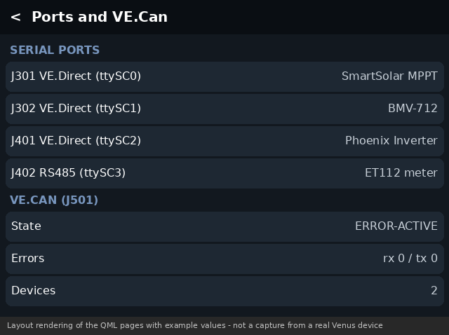
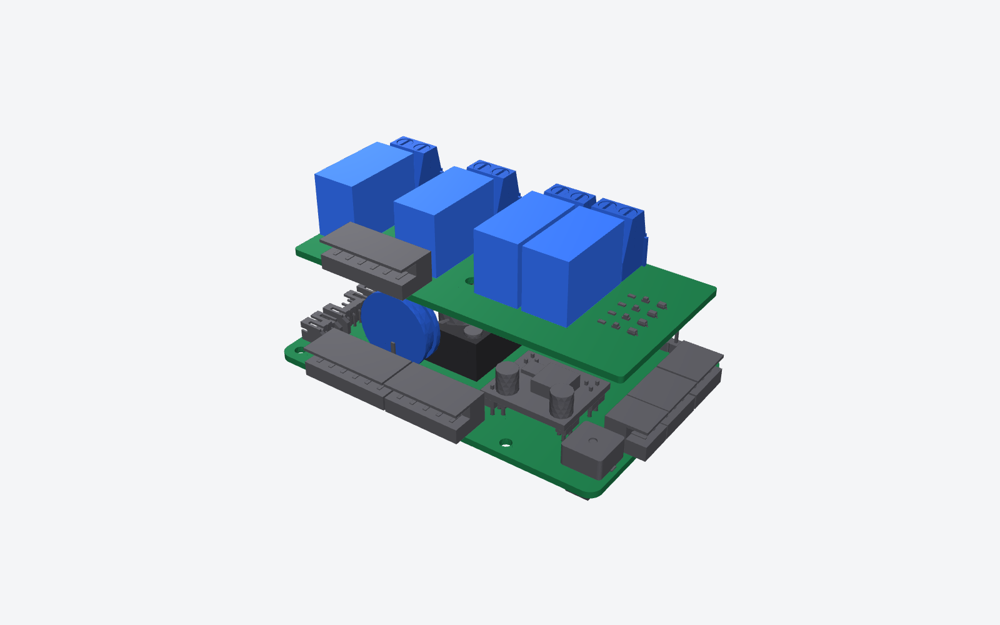

# Victron Raspberry Pi HAT (v45.3)

4-layer, 85 x 56 mm Raspberry Pi HAT for Victron Venus OS: VE.Direct, VE.Can, RS485, relays and inputs. Input 7-40 V, 5 V / 5 A from a plug-on 7Semi AP64500 module (U201). Fabrication: JLCPCB. Designer: Dilip Kumar TD.

## Board

| Top | Bottom |
|---|---|
|  |  |

## Status

- Unbuilt and untested. KiCad DRC: 0 errors, 0 unconnected.
- JLCPCB's own JLCDFM and 3D assembly preview have not been run. Run them before ordering.
- **Safety:** 7 A fuse F101 on the board. No reverse-polarity protection and no input TVS. Check polarity before connecting.
- **Thermal:** at 5 A the 5 V module U201 runs hot. Use a heatsink, extra copper or a lower load limit.

## Venus OS GUI





Classic GUI pages: [ALL-GUI-v1-classic-pages.png](03-GUI-screenshots/ALL-GUI-v1-classic-pages.png)

## 4-relay extension board



## Contents

| Path | Content |
|---|---|
| 01-PCB-v45.0/ | KiCad project, libraries, Gerbers, BOM, CPL, simulation, checks |
| 01-PCB-v45.0/JLCPCB/ | Gerber zip to upload to JLCPCB |
| 02-VenusOS-software-v4.2/ | Venus OS package (SetupHelper) and HAT EEPROM |
| 03-GUI-screenshots/, 04-3D-preview/ | GUI renderings, 3D preview |
| 05-relay-extension-v1.2/ | relay extension board |
| 07-tool-pcb-autorouter/ | Python autorouter |

## Install (Venus OS)

```
scp -r 02-VenusOS-software-v4.2 root@venus.local:/data/VictronHat
ssh root@venus.local /data/VictronHat/setup
```

Choose Install, then reboot. Needs kwindrem SetupHelper on the Pi. Relays and inputs also need RpiGpioSetup. Test on a spare SD card first.
