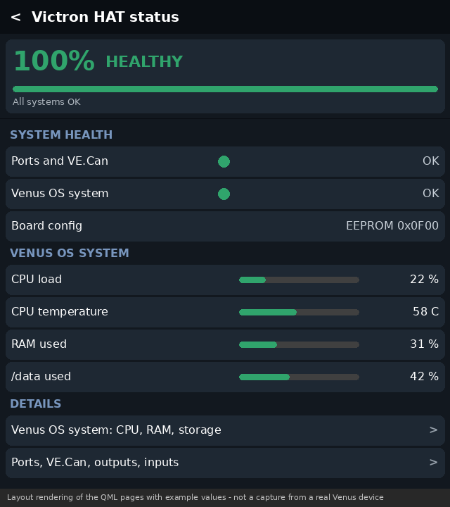
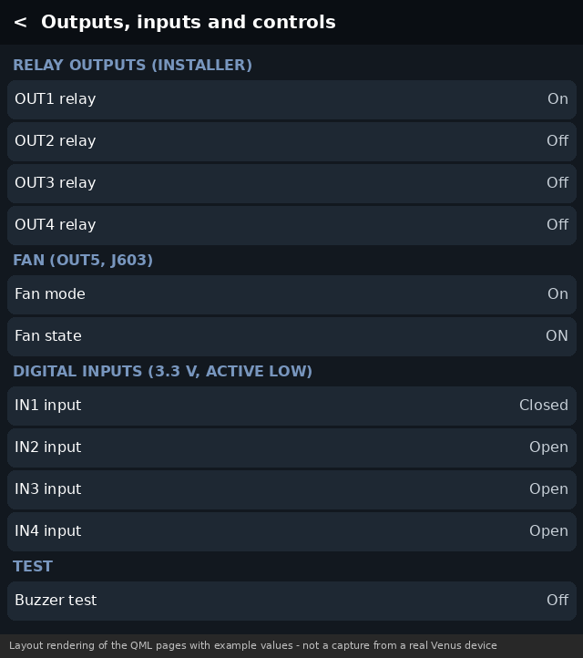
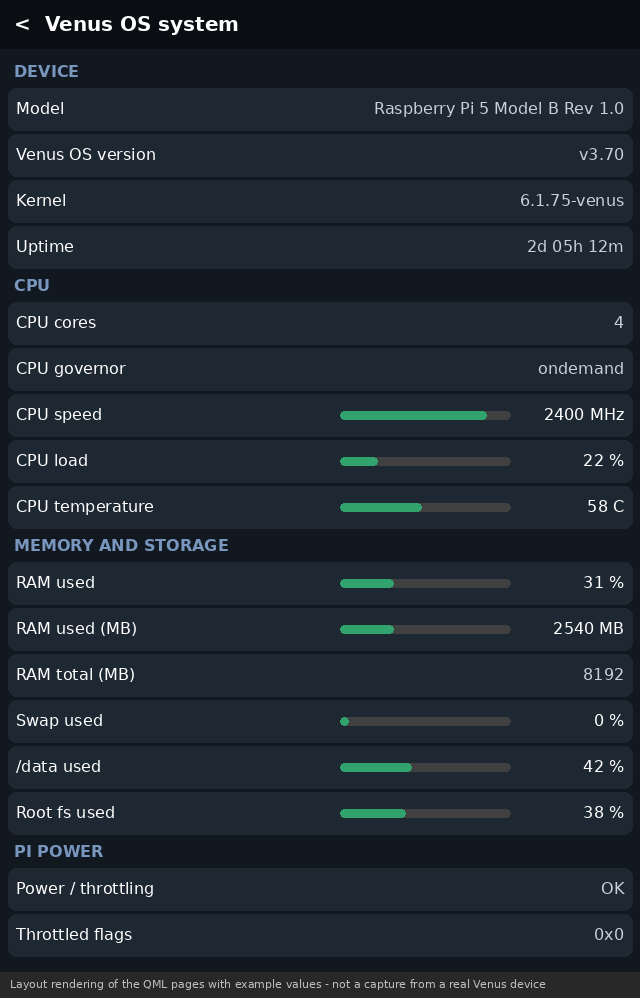

# Victron Raspberry Pi HAT (v45.3)

A 4-layer, 85 x 56 mm Raspberry Pi 5 HAT for Victron Venus OS. It adds three VE.Direct ports, VE.Can, RS485, four low-side relay outputs, four opto-isolated inputs, a fan output, a buzzer and a plug-on 5 V / 5 A supply for the Pi, all fed from a 7-40 V battery input. Fabrication: JLCPCB. Designer: Dilip Kumar TD.


## 1. Key specification

| Item | Value |
|---|---|
| Board | 85 x 56 mm, 4 layers, 1.6 mm, KiCad 7 |
| Input | 7-40 V DC at J101, 7 A fuse F101 |
| 5 V supply | 7Semi AP64500 plug-on module U201, fixed 5.0 V, 5 A, on 5 mm pins |
| Pi | Raspberry Pi 5 (Venus OS v3.70+, raspberrypi5 image), powered only through the HAT |
| Ports | VE.Direct x3 (J301, J302, J401), RS485 (J402), VE.Can (J501), 4 relay outputs (J601), 4 opto inputs 5-30 V (J701), fan (J602) |
| Chips | 2x SC16IS752 (UARTs), MCP2515 + SN65HVD230 (CAN), SP3485 (RS485), ULN2003A (relay drivers), TLP290-4 (opto inputs), 24LC32A (HAT ID EEPROM) |
| Protection | 7 A fuse F101, 5 V TVS D201 (P6SMB6.8CA). No reverse-polarity protection and no input TVS: check polarity before connecting |

## 2. PCB design

**Stack-up (JLCPCB 4-layer, 1.6 mm):** F.Cu signals and parts, In1.Cu solid GND plane, In2.Cu +5V plane, B.Cu signals, parts and power pours. Copper: 1 oz outer, 0.5 oz inner (JLCPCB default stack-up).

**Power paths:**
- Input VIN_RAW / VIN_F / VIN_P: 1.6 mm tracks plus B.Cu pours in parallel, joined by 0.8 / 0.4 mm via arrays, sized for 4.2 A (7 V in, 5 A out).
- +5V: pours at the module output pins, then the In2.Cu +5V plane. In v45.3 the +5V also continues on F.Cu and In1.Cu at the Pi supply corner, with a copper bridge (26.5-34.5 x 58-68.5 mm) and an In1.Cu +5V pour at the U201 output (wider copper where the supply narrows).
- GND: solid In1.Cu plane, F.Cu and B.Cu pours, stitching vias on a 3 mm grid.
- 5 V branches: Pi 2.5 A, display 3 A (PTC F102), relays and fan 2 A (PTC F601).

**Signals:**
- Net classes are stored in `victron-hat.kicad_pro` (see `01-PCB-v45.0/NETCLASSES.md`): signals 0.20 mm track, 0.15 mm clearance; fieldbus pairs (CAN, RS485) 0.4 mm with 0.30 mm clearance; VE.Direct pairs 0.25 mm; pour-free corridors beside the pairs.
- Vias: 0.6 / 0.3 mm for signals, 0.8 / 0.4 mm for power, 1.0 / 0.5 mm groups for high current.
- U201 is a THT module on 5 mm pins: pins 1-3 VIN, 4-9 GND, 10-12 +5V, with 1.8 mm pads.

**Manufacturing:** JLCPCB Gerber zip, BOM and CPL are in `01-PCB-v45.0/JLCPCB/` (bottom-side economic assembly). Hand-soldered parts are listed in `HAND-SOLDER-parts.csv` (terminals, JST connectors, Pi socket, buzzer, U201 pins). Silkscreen is clipped from pads, pin-1 marks are chamfered pads, and diode cathodes are marked by a bar.

**Checks:** KiCad DRC 0 errors / 0 unconnected / 0 footprint errors on v45.3. JLCPCB's own JLCDFM and 3D assembly preview have not been run: upload the Gerber zip there before paying. Known JLCDFM items: mask-opening and "( )" warnings, and a 2.40 mm THT-to-SMD gap between U201 pin 1 and IC701 pin 9 (warning).

## 3. Voltage drop (DC copper solve, full 5 A load, v45.3)

| Net | Result |
|---|---|
| +5V output, 5.0 A total | max drop 12.6 mV at the Pi header (J201), 5.7 mV display, 5.2 mV relay; copper loss 0.047 W |
| GND return | max drop 5.1 mV; copper loss 0.022 W |
| VIN_RAW / VIN_P | a few mV (see `01-PCB-v45.0/SIMULATION`) |

Current density peaks: +5V In2 1.02 A/mm, GND In1 1.93 A/mm (above the 1.25 A/mm inner-layer guide, in a few small spots between the Pi header GND pins), GND F.Cu 2.45 A/mm (limit 2.5). The Pi header gets about 4.98 V at 5 A with U201 at 5.00 V.

## 4. Thermal

Method: 2-D thermal sheet model of the board (0.25 mm grid), component losses plus copper I2R plus the U201 module loss, with still air or a 30 mm fan. Modelled; not measured on hardware.

| Case | Result |
|---|---|
| Copper I2R only, 5 A | temperature rise at most about 1 C |
| HAT with all ICs, U201 module excluded, 40 V in, 60 C ambient | stays below 70 C |
| U201 module itself at 5 A | loses 2.4-4.7 W; about 71-111 C with fan at 25 C ambient, up to about 131-187 C in still air at 60 C ambient |

**The 5 V module is the hot spot, not the board copper.** For a continuous 5 A load, fit a heatsink on U201, add copper under it, keep the fan fitted (30 mm fan over the 28 mm cutout), or limit the continuous load to about 3 A. Reports and heat maps: `01-PCB-v45.0/SIMULATION/` (THERMAL-*.md and thermal-*.png).

## 5. Port simulation

Calculated from the routed v45.3 board: series resistors, edge times, fault currents and routed lengths for every port.

- VE.Direct (3.3 V logic, 470 R series): TX high 3.25 V; a shorted TX pin draws about 7 mA, within the SC16IS752 limit; 5 V Victron TX is accepted (5 V-tolerant input).
- RS485 (SP3485) and CAN (SN65HVD230 + MCP2515): equal-length pairs, 120 R termination by jumper (JP401 / JP501, bus end only).
- Track-length skew between signals is at most about 0.1 ns, negligible against the slowest bit time (2 us for CAN at 500 kbit/s).
- Opto inputs: apply 5-30 V DC between INx and IN COM.

## 6. Venus OS GUI






The screenshots are layout renderings with example values, not captures from real hardware. Classic GUI pages: [ALL-GUI-v1-classic-pages.png](03-GUI-screenshots/ALL-GUI-v1-classic-pages.png)

## 7. 4-relay extension board


## 8. Install (Venus OS)

1. Write the HAT ID EEPROM once from Raspberry Pi OS (bridge JP801, run `eeprom/flash-eeprom.sh`).
2. On Venus OS install kwindrem SetupHelper, then:

```
scp -r 02-VenusOS-software-v4.2 root@venus.local:/data/VictronHat
ssh root@venus.local /data/VictronHat/setup
```

3. Choose Install, reboot, then Settings > Services > VE.Can port > "VE.Can & Lynx Ion BMS".
4. Relays and inputs need kwindrem RpiGpioSetup. Test on a spare SD card first.

Port wiring: J101 7-40 V (1 = -, 2 = +); J301/J302/J401 VE.Direct JST PH 4-pin; J402 RS485 A/B/GND; J501 CANH/CANL/GND; J601 OUT1-4 (0.5 A each, low-side), +5V, GND; J701 IN COM, IN1-IN4; J602 fan 5 V. Never plug USB-C into the Pi with the HAT fitted.

## 9. Contents

| Path | Content |
|---|---|
| 01-PCB-v45.0/ | KiCad project, libraries, Gerbers, BOM, CPL, simulation, checks |
| 01-PCB-v45.0/JLCPCB/ | Gerber zip to upload to JLCPCB |
| 02-VenusOS-software-v4.2/ | Venus OS package (SetupHelper) and HAT EEPROM |
| 03-GUI-screenshots/, 04-3D-preview/ | GUI renderings, 3D preview |
| 05-relay-extension-v1.2/ | relay extension board |
| 07-tool-pcb-autorouter/ | Python autorouter |
